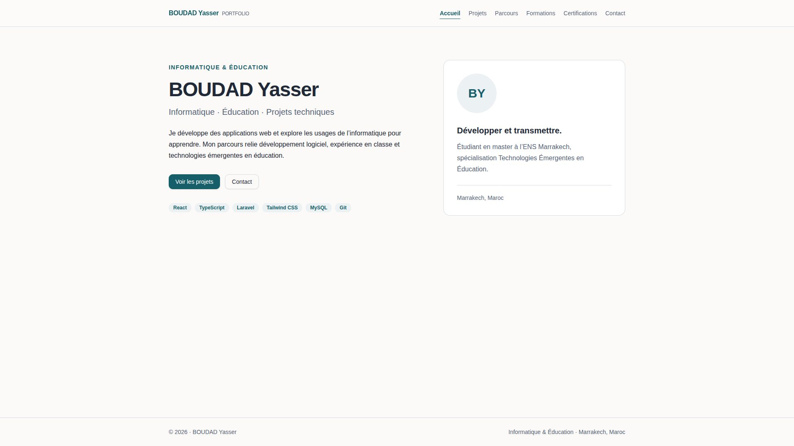
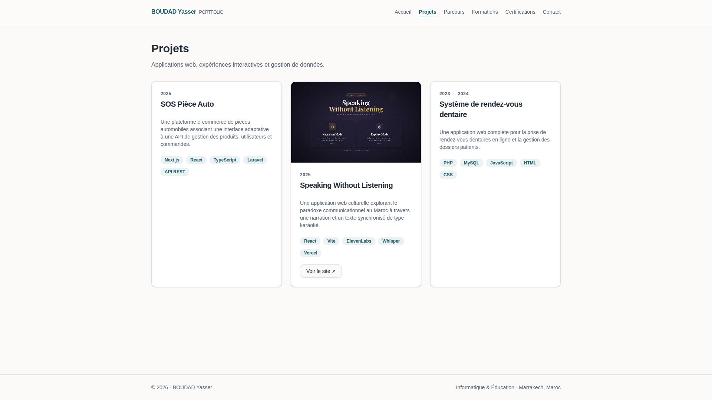
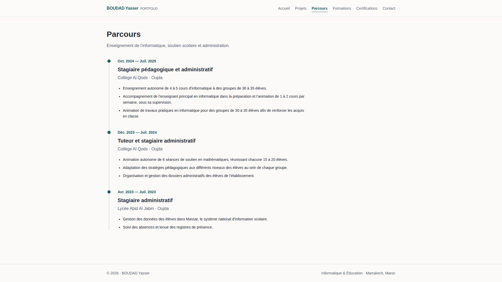
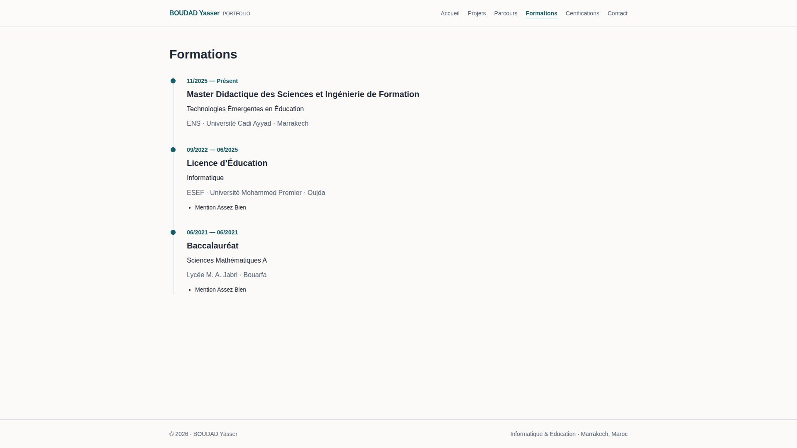
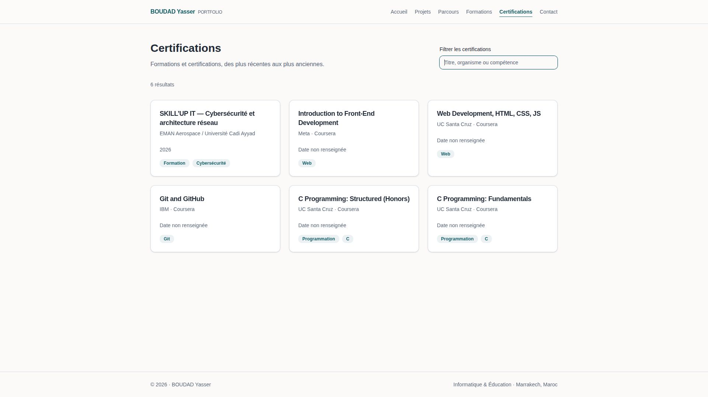
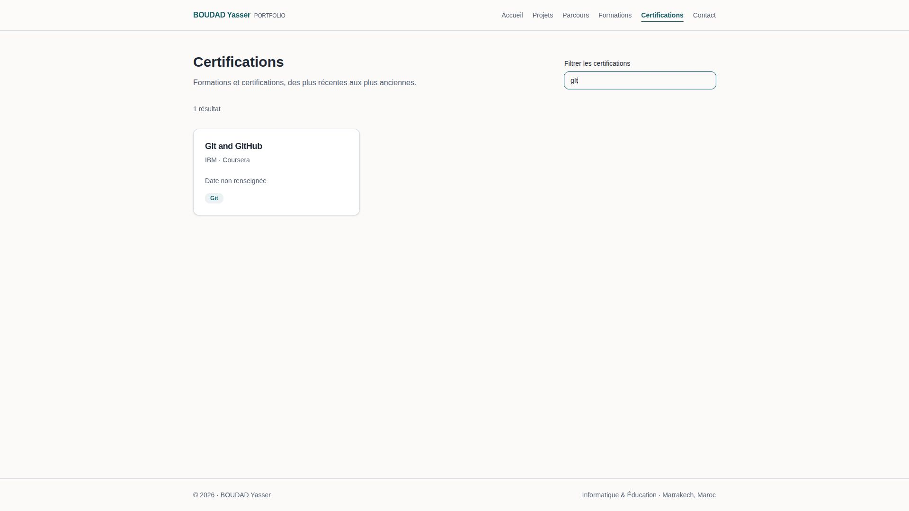
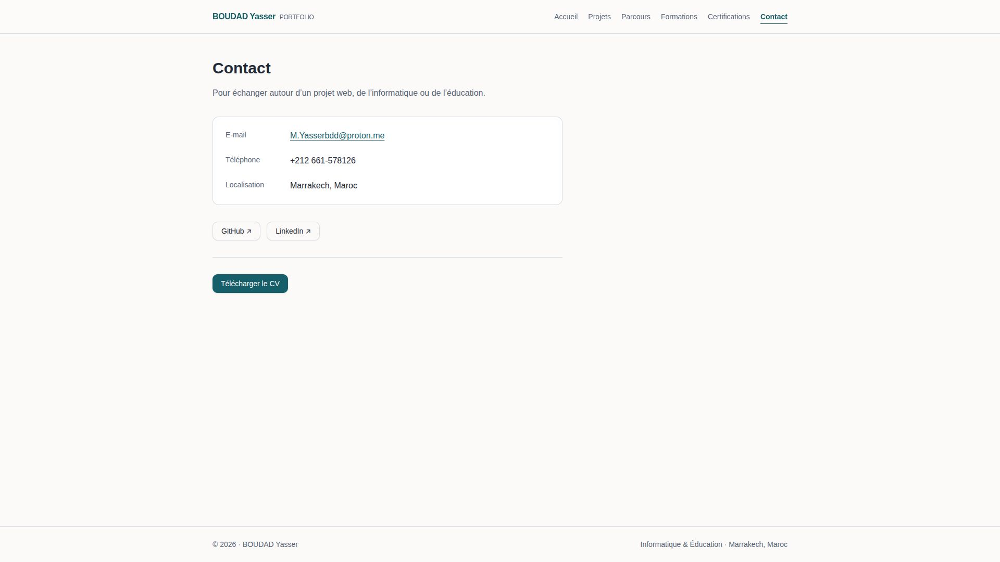

# Lab9-mon-portfolio

Portfolio React avec Vite et TypeScript : accueil, projets, parcours, formations, certifications et contact.

## Installation

Node.js 20.19 ou supérieur.

```bash
npm ci
npm run dev
```

Ouvrir l’adresse affichée dans le terminal.

## Vérifications

```bash
npm run format
npm run lint
npm run build
npm run preview
```

Le build TypeScript et Vite produit le dossier `dist/`.

## Organisation

- `src/app/` : React Router et layout partagé.
- `src/pages/` : les six pages du portfolio.
- `src/data/` : profil, projets, expériences, formations et certifications.
- `src/components/` : SEO avec Helmet, cartes de certifications et composants shadcn/ui.
- `public/` : CV et images locales.

Les certifications sont filtrées par titre, organisme, tags et compétences, puis triées par date décroissante. Les dates absentes sont affichées comme non renseignées et placées après les entrées datées.

## Certifications

Les huit entrées comprennent sept certifications avec une miniature WebP locale dans `public/certs/`, créée à partir du certificat PDF original. Les titres, organismes et dates proviennent des documents. Les cinq certifications Coursera disposent de leur lien de vérification ; les certifications Java et Hibernate & JPA de MLIAEdu proposent leur PDF. L’entrée de formation SKILL’UP IT reste sans image ni lien de certificat disponible.

## Déploiement Vercel

Importer le dépôt GitHub dans Vercel avec le framework Vite, la commande `npm run build` et le dossier de sortie `dist`. Le fichier `vercel.json` contient le fallback nécessaire aux routes React Router.

[Consulter le portfolio du TP9](https://portfolio-theta-orcin-eunar1nxnu.vercel.app/)

Le déploiement est accessible publiquement. La version en ligne vérifiée le 31 octobre 2026 précède l’ajout des nouvelles images et informations de certification.

## Portfolio personnel antérieur au TP9

[Consulter mon portfolio personnel](https://portfolio-kosys.vercel.app/)

Ce portfolio a été réalisé avant ce laboratoire. Il s’agit d’une version distincte du projet présenté dans ce dépôt.

Lors de la vérification du 31 octobre 2026, cette adresse redirige vers une connexion Vercel ; son contenu n’a donc pas pu être vérifié publiquement.

## Résultats

- Formatage, lint et build TypeScript/Vite réussis.
- Navigation entre les six pages et rechargement direct d’une route vérifiés dans l’aperçu de production.
- Filtre des certifications vérifié avec « gIt », puis avec une recherche sans résultat.
- Affichage mobile vérifié sur les six pages, sans débordement horizontal.
- Titres et descriptions propres à chaque page ; aucune erreur dans la console pendant ces vérifications.

## Captures

Captures de la version initiale, avant l’ajout des certificats PDF et de leurs miniatures.














